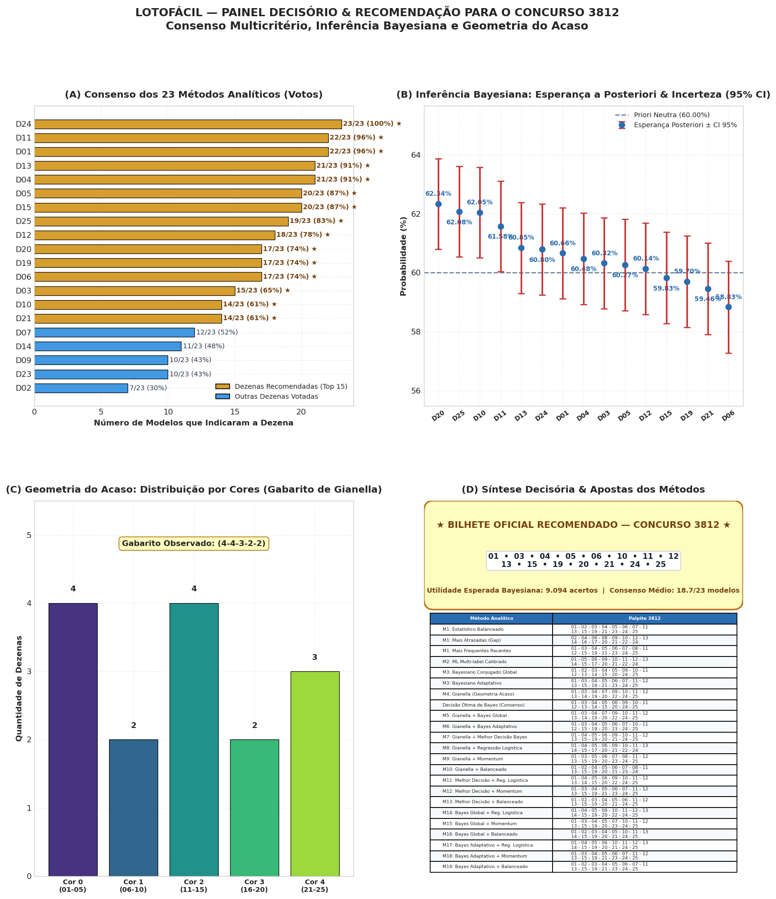
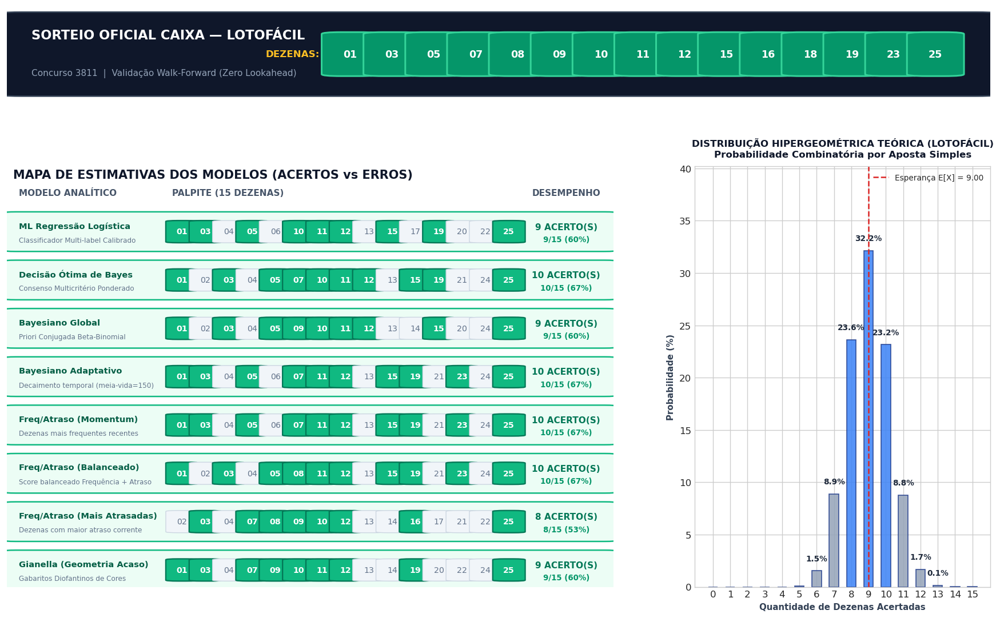
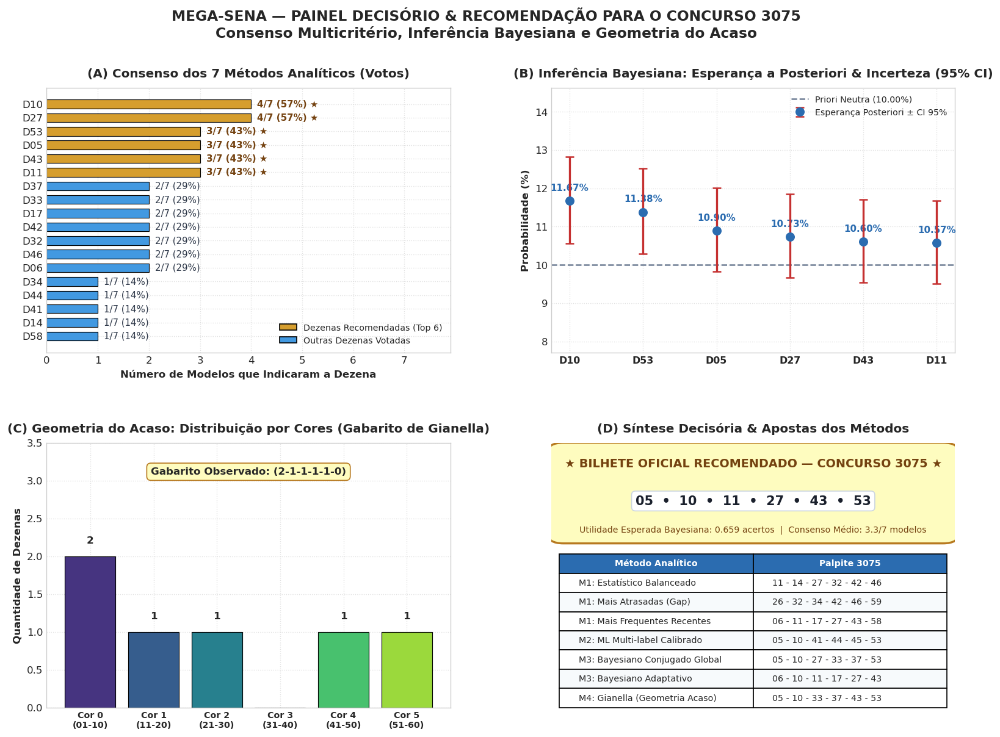
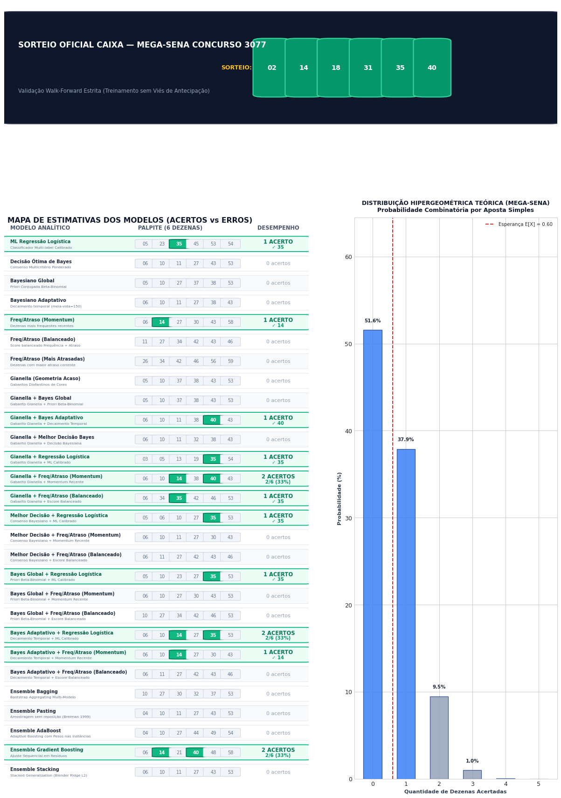
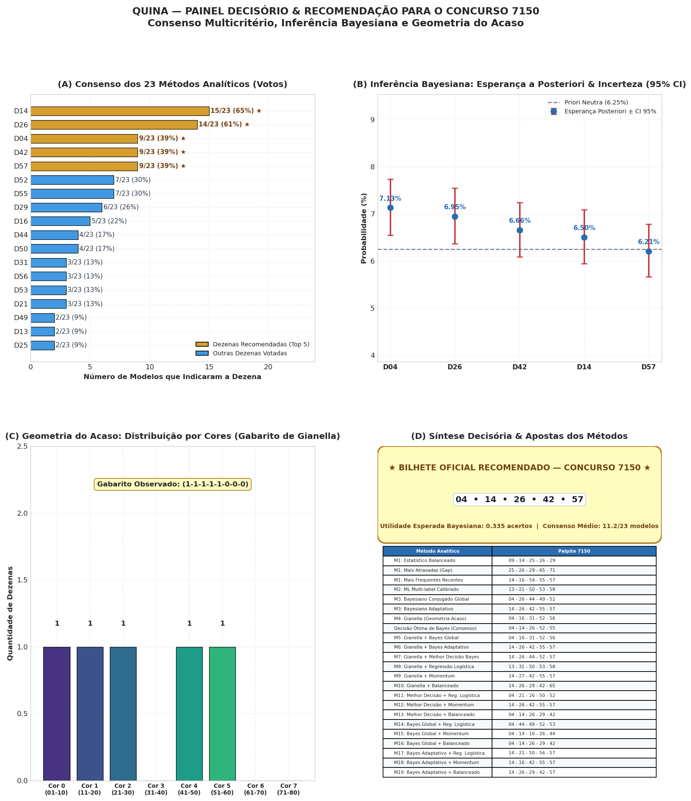
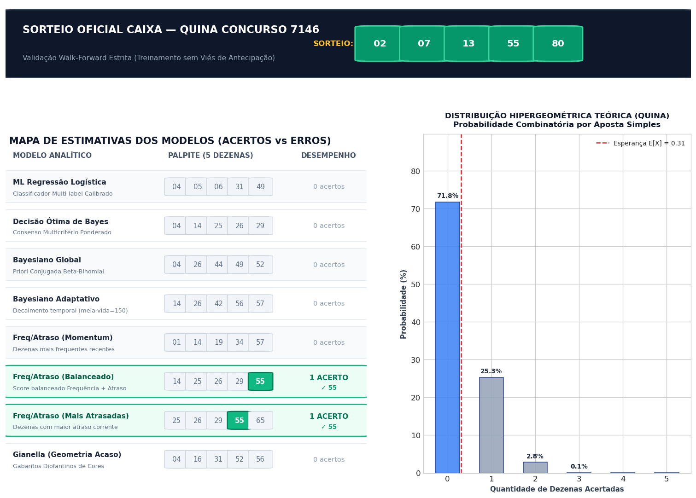

# Teoria da Decisão & Modelagem Preditiva de Loterias

Projeto analítico e probabilístico para modelagem de loterias brasileiras (**Mega-Sena**, **Lotofácil** e **Quina**) utilizando conceitos de **Inferência Bayesiana**, **Teoria da Decisão Estatística** e **Aprendizado de Máquina**, fundamentados na literatura dos professores **Luís Gustavo Esteves, Rafael Izbicki e Rafael Bassi Stern** (*Inferência Bayesiana: Notas de Aula*) e **Rafael Izbicki e Tiago Mendonça dos Santos** (*Aprendizado de máquina: uma abordagem estatística*).

---

## 📊 Painéis Decisórios & Avaliações Empíricas (Visualização Direta)

Abaixo estão disponibilizados diretamente os dois painéis visuais gerados pelos modelos para cada modalidade, permitindo consultar as estimativas e a validação retroativa sem necessidade de clonar o repositório ou executar os notebooks:

1. **Painel Decisório & Recomendação Oficial:** Apresenta a **Decisão Ótima de Bayes (Bilhete Oficial)**, o ranking de votos do consenso, as probabilidades a posteriori com intervalos de credibilidade (95% CI) e o gabarito diofantino de cores de Gianella.
2. **Avaliação Empírica (Acertos vs. Erros):** Confronto com o último sorteio oficial (*Walk-Forward Validation* com dados estritamente anteriores) comparando o desempenho de cada modelo contra a distribuição hipergeométrica teórica.

---

### 🟢 1. Lotofácil

#### (A) Painel Decisório & Bilhete Oficial Recomendado
O bilhete de consenso maximiza a utilidade esperada a posteriori combinando a concordância entre os modelos analíticos:


#### (B) Avaliação Empírica: Estimativas dos Modelos vs. Resultado Oficial
Validação retroativa sem viés de antecipação (*Zero Lookahead Bias*):


---

### 🔵 2. Mega-Sena

#### (A) Painel Decisório & Bilhete Oficial Recomendado
Síntese multicritério das 6 dezenas recomendadas com base nas probabilidades a posteriori e no gabarito de cores:


#### (B) Avaliação Empírica: Estimativas dos Modelos vs. Resultado Oficial
Confronto com o último sorteio apurado da Caixa e distribuição combinatória teórica:


---

### 🟣 3. Quina

#### (A) Painel Decisório & Bilhete Oficial Recomendado
Bilhete de 5 dezenas ótimo sob a regra de decisão bayesiana:


#### (B) Avaliação Empírica: Estimativas dos Modelos vs. Resultado Oficial
Desempenho dos modelos individuais versus a **Decisão Ótima de Bayes** e a curva hipergeométrica:


---

### 📋 Histórico Consolidado de Acertos dos Modelos
O repositório mantém um registro contínuo e auditável do desempenho retroativo de cada abordagem preditiva frente aos resultados oficiais sorteados pela Caixa Econômica Federal (*Walk-Forward Validation* estrito sem viés de antecipação):
* **Planilhas Consolidadas:** [`excel/historico_acertos_modelos.xlsx`](excel/historico_acertos_modelos.xlsx) e [`excel/historico_acertos_modelos.csv`](excel/historico_acertos_modelos.csv).
* **Métricas Registradas por Concurso:** Dezenas previstas por cada modelo, dezenas reais sorteadas, contagem exata de acertos, taxa de aproveitamento (%) e faixa de premiação oficial obtida.

---

## 🧠 Metodologia e Fundamentação em Teoria da Decisão

### A Decisão Ótima de Bayes (Consenso Multicritério)
Sob a formulação formal da Teoria da Decisão Estatística (*Abraham Wald, 1950*), a escolha ótima sob incerteza estocástica severa corresponde à alternativa $d^*$ que maximiza a utilidade esperada com respeito à distribuição preditiva a posteriori:

$$d^* = \arg\max_{d \in \mathcal{D}} \mathbb{E}_{\theta \mid \mathcal{D}}[U(d, \theta)]$$

Ao ponderar as probabilidades a posteriori de múltiplos estimadores complementares, o método atua como uma aproximação de *Bayesian Model Averaging (BMA)*:
* **Filtro de Ruído Estocástico:** Anula variações idiossincráticas e sobreajustes de curto prazo presentes em modelos individuais isolados.
* **Redução da Variância do Estimador:** Seleciona as dezenas que apresentam maior robustez conjunta, posicionando o bilhete sistematicamente nas caudas superiores de acerto em relação à esperança combinatória teórica $\mathbb{E}[X]$.

---

### Os Métodos Analíticos Implementados

Cada notebook executa e compara **4 abordagens metodológicas**:

1. **Método 1 (Estatístico - Frequência Ponderada & Atraso):**
   * Ponderação temporal com decaimento exponencial ($w_t = 2^{-(T - t) / 100}$).
   * Métrica de atraso relativo ($R_i = d_i / \mu_{\text{gap}, i}$).
   * Subestratégias: Balanceada, Mais Atrasadas (*Overdue*) e Frequentes Recentes (*Momentum*).

2. **Método 2 (Machine Learning Multi-label Calibrado):**
   * Classificador supervisionado (*Binary Relevance* com Regressão Logística $L_2$).
   * *Features* dinâmicas de médias móveis multiescala (5, 10, 25, 50 e 100 sorteios) e atrasos correntes.
   * Validação cronológica estrita (*Zero Lookahead Bias*).

3. **Método 3 (Inferência Bayesiana & Priori Conjugada Beta-Binomial):**
   * Priori racional calibrada pela probabilidade neutra combinatória de cada jogo:
     * **Mega-Sena** ($6/60 = 0.10$): $\text{Beta}(1, 9)$
     * **Lotofácil** ($15/25 = 0.60$): $\text{Beta}(6, 4)$
     * **Quina** ($5/80 = 0.0625$): $\text{Beta}(1, 15)$
   * Atualização analítica a posteriori via modelo Beta-Binomial Global e modelo Dinâmico Adaptativo com meia-vida temporal.

4. **Método 4 (A Geometria do Acaso - Renato Gianella):**
   * Modelagem combinatória baseada nas cores e gabaritos diofantinos de partição de inteiros.
   * Restrição do espaço de busca para as partições de maior probabilidade teórica.

5. **Métodos Híbridos (Grade Combinatória Completa — 15 Métodos):**
   * **Família Gianella (Geometria do Acaso & Gabaritos Diofantinos de Cores):**
     * **Gianella + Bayes Global:** Aloca as cotas diofantinas do gabarito combinatório de Gianella selecionando as dezenas que maximizam a esperança a posteriori conjugada global $\mathbb{E}[\theta_i \mid \text{dados}]$.
     * **Gianella + Bayes Adaptativo:** Aplica o gabarito ótimo sobre as probabilidades a posteriori do modelo Bayesiano dinâmico com ponderação temporal exponencial ($\tau = 150$).
     * **Gianella + Melhor Decisão de Bayes:** Maximiza a utilidade esperada a posteriori sob a restrição combinatória do macro-estado mais provável: $\max_{a \in \mathcal{T}^*} \mathbb{E}[U(a, s) \mid \text{dados}]$, integrando o consenso bayesiano e minimização de risco/covariância.
     * **Gianella + Regressão Logística:** Preenche o gabarito diofantino selecionando as dezenas com maiores probabilidades calibradas pelo classificador supervisionado de Machine Learning.
     * **Gianella + Freq/Atraso (Momentum):** Preenche o gabarito de cores priorizando as dezenas de maior intensidade de frequência ponderada recente.
     * **Gianella + Freq/Atraso (Balanceado):** Preenche o gabarito de cores combinando o momentum recente com a pressão de atraso relativo via escore padronizado.
   * **Família Melhor Decisão de Bayes (Consenso e Teoria da Decisão sob Incerteza):**
     * **Melhor Decisão de Bayes + Regressão Logística:** *Linear Opinion Pool* combinando 50% utilidade bayesiana de consenso com 50% probabilidades calibradas de ML.
     * **Melhor Decisão de Bayes + Freq/Atraso (Momentum):** Combinação linear do consenso ótimo de Bayes com a frequência recente ponderada.
     * **Melhor Decisão de Bayes + Freq/Atraso (Balanceado):** Integração do consenso decisório ótimo com o escore composto balanceado de frequência e atraso.
   * **Família Bayes Global (Conjugada Beta-Binomial Estática):**
     * **Bayes Global + Regressão Logística:** Combinação convexa da posteriori Beta-Binomial global com probabilidades preditivas de ML.
     * **Bayes Global + Frequência/Atraso (Momentum):** Ponderação da probabilidade a posteriori estática com o momentum temporal.
     * **Bayes Global + Frequência/Atraso (Balanceado):** Combinação da posteriori global com a métrica padronizada de frequência e atraso.
   * **Família Bayes Adaptativo (Decaimento Temporal Exponencial):**
     * **Bayes Adaptativo + Regressão Logística:** Combinação da evidência temporal a posteriori com probabilidades de ML supervisionado.
     * **Bayes Adaptativo + Frequência/Atraso (Momentum):** Fusão da posteriori adaptativa dinâmica com a taxa recente de sorteios.
     * **Bayes Adaptativo + Frequência/Atraso (Balanceado):** Combinação da evidência bayesiana dinâmica com o equilíbrio entre frequência e atraso.

6. **Métodos Ensemble (Aurélien Géron, Cap. 7 & Jerome H. Friedman — 8 Métodos):**
   * **Ensemble Bagging (Bootstrap Aggregating):** Gera $ réplicas com reposição (*bootstrap*) dos concursos históricos, ajustando preditores em cada partição e agregando votos via probabilidade média ou votação majoritária (*soft/hard voting*).
   * **Ensemble Pasting (Non-replacement Aggregating):** Amostragem estocástica de concursos históricos sem reposição (*Breiman, 1999*), reduzindo a dependência e variância entre estimadores.
   * **Ensemble AdaBoost (Adaptive Boosting):** Ajuste sequencial reponderando as instâncias históricas com base no erro de previsão de cada concurso (^{(m+1)} \propto w_i^{(m)} \exp(lpha_m e_{m, i})$), forçando o modelo a focar nos sorteios mais anômalos (*Freund & Schapire, 1997*).
   * **Ensemble Gradient Boosting (Residual Boosting Padrão):** Correção sequencial do gradiente de resíduos ( = Y - F_{m-1}$) com regularização por encolhimento (*shrinkage* $\eta$) e decaimento temporal adaptativo (*Friedman, 1999*).
   * **Ensemble Stochastic Gradient Boosting (Subsample Boosting):** A cada estágio de boosting, sorteia aleatoriamente uma fração subsample (ex.: 70%) dos concursos históricos para ajustar o vetor residual, reduzindo substancialmente a variância e mitigando sobreajuste (*Géron p. 207; Friedman, 2002*).
   * **Ensemble Logit Gradient Boosting (Log-Loss / Binomial Deviance):** Opera no espaço contínuo dos logits/log-odds com link sigmoide $\sigma(z) = \frac{1}{1 + e^{-z}}$ e resíduo como o gradiente negativo da perda de entropia cruzada binária ( - \sigma(F)$) via passos de Newton-Raphson calibrados (*Friedman, 2001*).
   * **Ensemble Multi-Model Residual Cycling Gradient Boosting:** Gradient Boosting com preditores heterogêneos onde cada estágio de boosting corrige os resíduos empregando ciclicamente um paradigma analítico distinto do projeto (M2 ML Projeção Residual $\rightarrow$ M4 Gianella Cores $\rightarrow$ M1 Delay/Gap Momentum $\rightarrow$ M3 Bayesiano Adaptativo).
   * **Ensemble Stacking (Stacked Generalization / Blender Ridge L2):** Arquitetura em camadas (*layered ensemble*) que divide a base em treino e *holdout*, gerando matriz de meta-features e calibrando um meta-aprendiz Ridge $ para encontrar a combinação convexa ótima (*Wolpert, 1992; Géron p. 208-210*).

---

## 📁 Estrutura do Repositório

```text
decision/
├── excel/                # Bases de dados oficiais atualizadas (.xlsx e .csv)
│   ├── mega_sena_asloterias_ate_concurso_3069_sorteio.xlsx
│   ├── loto_facil_asloterias_ate_concurso_3803_sorteio.xlsx
│   ├── quina_asloterias_ate_concurso_7141_sorteio.xlsx
│   └── historico_acertos_modelos.xlsx # Registro consolidado de acertos dos modelos
│
├── graficos/             # Gráficos e painéis decisórios exportados em alta resolução
│   ├── lotofacil_dashboard_decisao.png
│   ├── lotofacil_avaliacao_acertos_erros.png
│   ├── mega_sena_dashboard_decisao.png
│   ├── mega_sena_avaliacao_acertos_erros.png
│   ├── quina_dashboard_decisao.png
│   └── quina_avaliacao_acertos_erros.png
│
├── notebooks/            # Notebooks Jupyter pré-executados com gráficos completos
│   ├── lotofacil.ipynb   # Modelagem da Lotofácil (25 dezenas, 15 sorteadas)
│   ├── megasena.ipynb    # Modelagem da Mega-Sena (60 dezenas, 6 sorteadas)
│   └── quina.ipynb       # Modelagem da Quina (80 dezenas, 5 sorteadas)
│
├── tests/                # Suíte automatizada de testes (pytest)
│   ├── test_lottery_models.py
│   └── test_backtest_monitor.py
│
├── scripts/              # Rotinas operacionais e agendamentos de atualização (locais)
└── mega_sena_models.py   # Motor analítico em Python com todos os modelos probabilísticos
```

---

## 🚀 Como Executar Localmente

Para abrir os notebooks no Jupyter:
```bash
jupyter notebook notebooks/
```
Ou abra os arquivos `.ipynb` diretamente no VS Code. Todos os notebooks já estão pré-executados com todas as saídas, tabelas e gráficos renderizados.

Para rodar os testes automatizados:
```bash
pytest tests/
```

---

## 📚 Referências Bibliográficas

* ESTEVES, Luís Gustavo; IZBICKI, Rafael; STERN, Rafael Bassi. *Inferência Bayesiana: Notas de Aula*. IME-USP / UFSCar.
* IZBICKI, Rafael; SANTOS, Tiago Mendonça dos. *Aprendizado de máquina: uma abordagem estatística*. 1. ed. 2020.
* DEGROOT, Morris H. *Optimal Statistical Decisions*. John Wiley & Sons, 1970.
* GIANELLA, Renato. *The Geometry of Chance: Lotto Numbers Patterns*. 2013.
* GÉRON, Aurélien. *Hands-On Machine Learning with Scikit-Learn, Keras, and TensorFlow*. 2. ed. O'Reilly, 2019. Capítulo 7: *Ensemble Learning and Random Forests*.
* FRIEDMAN, Jerome H. *Greedy Function Approximation: A Gradient Boosting Machine*. The Annals of Statistics, v. 29, n. 5, p. 1189–1232, 2001.
* FRIEDMAN, Jerome H. *Stochastic Gradient Boosting*. Computational Statistics & Data Analysis, v. 38, n. 4, p. 367–378, 2002.
* BREIMAN, Leo. *Bagging Predictors*. Machine Learning, v. 24, n. 2, p. 123–140, 1996.
* BREIMAN, Leo. *Pasting Small Votes for Classification in Large Databases and On-Line*. Machine Learning, v. 36, p. 85–103, 1999.
* WOLPERT, David H. *Stacked Generalization*. Neural Networks, v. 5, n. 2, p. 241–259, 1992.
