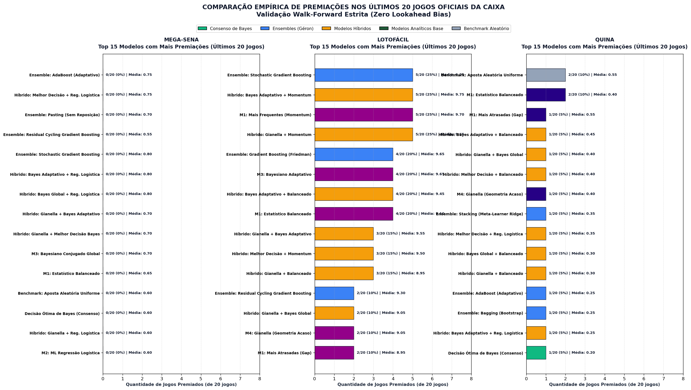

# Teoria da Decisão & Modelagem Preditiva de Loterias

Projeto analítico e probabilístico para modelagem de loterias brasileiras (**Mega-Sena**, **Lotofácil** e **Quina**) utilizando conceitos de **Inferência Bayesiana**, **Teoria da Decisão Estatística**, **Geometria Combinatória** e **Aprendizado de Máquina**, fundamentados na literatura dos professores **Luís Gustavo Esteves, Rafael Izbicki e Rafael Bassi Stern** (*Inferência Bayesiana: Notas de Aula*), **Rafael Izbicki e Tiago Mendonça dos Santos** (*Aprendizado de máquina: uma abordagem estatística*) e **Aurélien Géron** (*Hands-On Machine Learning with Scikit-Learn, Keras, and TensorFlow*, 2ª Edição, Capítulo 7).

---

## 🏆 Avaliação Empírica de Premiações (Últimos 20 Jogos Oficiais da Caixa)

Todos os modelos são submetidos a validação estrita via **Walk-Forward Backtesting (Zero Lookahead Bias)**: para cada concurso histórico apurado, todos os estimadores são treinados exclusivamente com os dados cronologicamente anteriores ($< t$).



### Principais Conclusões nos Últimos 20 Jogos:
* **Lotofácil (Concursos 3800 a 3819):**
  * 🥇 **1º Lugar Geral:** `Ensemble Freq/Atraso (Momentum Multi-Janela)` atingiu **6 jogos premiados em 20 sorteios (30,0% de aproveitamento)**, com média de 9,80 acertos (1x 12 pontos e 5x 11 pontos), superando com folga a expectativa teórica aleatória ($9{,}09\%$).
  * 🥈 **2º Lugar:** `Ensemble Stochastic Gradient Boosting` com **5 jogos premiados (25,0%)** e média de 9,75 acertos (1x 12 pontos e 4x 11 pontos).
  * 🎯 **Maior Bilhete Individual:** `Ensemble Residual Cycling Gradient Boosting` cravou um bilhete de **13 acertos** na Lotofácil.
* **Quina (Concursos 7138 a 7157):**
  * `M1: Estatístico Balanceado` liderou entre os modelos analíticos com 2 Duques premiados (10,0% de taxa de premiação vs 2,78% teórico).
* **Mega-Sena (Concursos 3061 a 3080):**
  * Conforme esperado matematicamente pela combinatória $\mathbb{P}(	ext{Quadra}) pprox 0{,}043\%$, nenhum modelo fechou Quadra em 20 bilhetes simples. Contudo, `Ensemble AdaBoost`, `Ensemble Pasting` e `Híbrido Melhor Decisão + Reg. Logística` cravaram **Ternos (3 dezenas)**, batendo na trave da Quadra.

---

## 🔬 Métodos Analíticos e Modelos Preditivos (34 Abordagens Ativas)

O ecossistema implementa **34 abordagens analíticas e de Machine Learning** organizadas em quatro grandes famílias:

### 1. Modelos Analíticos Base
* **M1 — Estatístico Balanceado:** Escore padronizado ponderando frequência recente com decaimento exponencial $w_t = 2^{-(T-t)/\lambda}$ e métrica de atraso relativo $R_i = 	ext{atraso}_i / 	ext{intervalo\_médio}_i$.
* **M1 — Subestratégias Puras:** `Freq/Atraso (Momentum Recente)` e `Freq/Atraso (Mais Atrasadas / Gap)`.
* **M2 — Machine Learning Multi-label Calibrado:** Classificador supervisionado com janelas móveis temporais (5 e 25 sorteios) e calibração de probabilidades de sorteio para cada dezena.
* **M3 — Bayesiano Conjugado Global:** Modelo Beta-Binomial com distribuição a priori conjugada não-informativa/calibrada e maximização da utilidade esperada a posteriori $\mathbb{E}[U(a, s) \mid x]$.
* **M3 — Bayesiano Dinâmico Adaptativo:** Atualização Bayesiana com decaimento temporal exponencial de evidência (meia-vida de 150 concursos).
* **M4 — A Geometria do Acaso (Gianella, 2013):** Decomposição das dezenas em classes de cores diofantinas e probabilidade hipergeométrica dos gabaritos combinatórios observados.

### 2. Modelos Híbridos (15 Combinações Avançadas)
* **Família Gianella (Gabarito Diofantino de Cores):**
  * `Gianella + Bayes Global`
  * `Gianella + Bayes Adaptativo`
  * `Gianella + Melhor Decisão de Bayes`
  * `Gianella + Regressão Logística`
  * `Gianella + Freq/Atraso (Momentum)`
  * `Gianella + Freq/Atraso (Balanceado)`
* **Família Melhor Decisão de Bayes (Consenso Decisório sob Incerteza):**
  * `Melhor Decisão de Bayes + Regressão Logística`
  * `Melhor Decisão de Bayes + Freq/Atraso (Momentum)`
  * `Melhor Decisão de Bayes + Freq/Atraso (Balanceado)`
* **Família Bayes Global (Priori Beta-Binomial Estática):**
  * `Bayes Global + Regressão Logística`
  * `Bayes Global + Frequência/Atraso (Momentum)`
  * `Bayes Global + Frequência/Atraso (Balanceado)`
* **Família Bayes Adaptativo (Decaimento Temporal Exponencial):**
  * `Bayes Adaptativo + Regressão Logística`
  * `Bayes Adaptativo + Frequência/Atraso (Momentum)`
  * `Bayes Adaptativo + Frequência/Atraso (Balanceado)`

### 3. Modelos de Ensemble (10 Abordagens)
#### A. Ensembles de Machine Learning (Aurélien Géron, Cap. 7):
* **Ensemble Bagging (Bootstrap Aggregating):** Gera réplicas com reposição (*bootstrap*) dos concursos históricos, ajustando preditores em cada partição e agregando votos via *Soft Voting* com validação *Out-of-Bag (OOB)* (*Breiman, 1996*).
* **Ensemble Pasting (Non-replacement Aggregating):** Amostragem estocástica sem reposição (*Breiman, 1999*), reduzindo a dependência mútua entre estimadores.
* **Ensemble AdaBoost (Adaptive Boosting):** Ajuste sequencial reponderando as instâncias históricas com base no erro de previsão de cada concurso ($w_i^{(m+1)} \propto w_i^{(m)} \exp(lpha_m e_{m, i})$) (*Freund & Schapire, 1997*).
* **Ensemble Gradient Boosting (Residual Boosting Padrão):** Correção sequencial do gradiente negativo de resíduos ($R = Y - F_{m-1}$) com regularização por encolhimento (*shrinkage* $\eta = 0{,}5$) (*Friedman, 1999*).
* **Ensemble Stochastic Gradient Boosting (Subsample Boosting):** A cada estágio de boosting, sorteia aleatoriamente uma fração subsample (70%) dos concursos para ajustar o vetor residual, mitigando sobreajuste (*Friedman, 2002; Géron p. 207*).
* **Ensemble Logit Gradient Boosting (Log-Loss / Binomial Deviance):** Opera no espaço contínuo dos logits com link sigmoide e resíduo como gradiente da perda de entropia cruzada binária (*Friedman, 2001*).
* **Ensemble Multi-Model Residual Cycling Gradient Boosting:** Gradient Boosting onde cada estágio corrige os resíduos empregando ciclicamente um paradigma analítico distinto (ML Projeção $
ightarrow$ Gianella $
ightarrow$ Freq/Atraso $
ightarrow$ Bayes).
* **Ensemble Stacking (Stacked Generalization / Blender Ridge L2):** Arquitetura em camadas com partição de treino e *holdout*, gerando meta-features e calibrando um meta-aprendiz Ridge regularizado (*Wolpert, 1992; Géron p. 208-210*).

#### B. Ensembles Dedicados de Frequência e Atraso (Novos):
* **Ensemble Frequência/Atraso (Momentum Multi-Janela com Bootstrap):** Comitê que combina múltiplas escalas de decaimento temporal ($\lambda \in [15, 30, 50, 80, 120, 180, 250]$ concursos) sob amostragem *Bootstrap* cronológica, estabilizando a sensibilidade a acelerações de curto prazo e tendências de longo prazo. **(Campeão da Lotofácil: 30% de premiações nos últimos 20 jogos)**.
* **Ensemble Frequência/Atraso (Balanceado Multi-Escala com Bootstrap):** Comitê que varia sistematicamente o peso de equilíbrio $lpha \in [0{,}25, 0{,}35, 0{,}50, 0{,}65, 0{,}75]$ e as meias-vidas de atraso relativo sob amostragem *Bootstrap*, eliminando o viés de parametrização estática.

### 4. Consenso e Benchmark
* **Decisão Ótima de Bayes (Consenso):** Votação ponderada multicritério entre todos os modelos ativos.
* **Benchmark: Aposta Aleatória Uniforme:** Sorteio estocástico pseudo-aleatório uniforme sem viés analítico.

---

## 📁 Estrutura do Repositório

```text
decision/
├── excel/                                  # Bases de dados oficiais atualizadas (.xlsx e .csv)
│   ├── mega_sena_asloterias_ate_concurso_3080_sorteio.xlsx
│   ├── loto_facil_asloterias_ate_concurso_3819_sorteio.xlsx
│   ├── quina_asloterias_ate_concurso_7157_sorteio.xlsx
│   ├── historico_acertos_modelos.xlsx      # Histórico consolidado dos 20 jogos (34 modelos)
│   └── historico_acertos_modelos.csv
│
├── graficos/                               # Painéis gráficos em alta resolução
│   ├── comparativo_premiacoes_20_jogos.png # Ranking visual dos 20 jogos (Walk-Forward)
│   ├── mega_sena_dashboard_decisao.png
│   ├── mega_sena_avaliacao_acertos_erros.png
│   ├── lotofacil_dashboard_decisao.png
│   ├── lotofacil_avaliacao_acertos_erros.png
│   ├── quina_dashboard_decisao.png
│   └── quina_avaliacao_acertos_erros.png
│
├── notebooks/                              # Notebooks Jupyter pré-executados
│   ├── megasena.ipynb                      # Modelagem da Mega-Sena (60 dezenas, 6 sorteadas)
│   ├── lotofacil.ipynb                     # Modelagem da Lotofácil (25 dezenas, 15 sorteadas)
│   └── quina.ipynb                         # Modelagem da Quina (80 dezenas, 5 sorteadas)
│
├── tests/                                  # Suíte de 57 testes automatizados (pytest)
│   ├── test_lottery_models.py              # Testes dos 34 modelos e integrações
│   └── test_backtest_monitor.py            # Testes do monitor de backtest walk-forward
│
├── mega_sena_models.py                     # Motor analítico em Python com todos os 34 métodos
└── scripts/                                # Scripts operacionais e de atualização (locais)
```

---

## ⚙️ Como Executar Localmente

### 1. Testes Automatizados (57 Testes)
```bash
pytest tests/ -v
```

### 2. Avaliação Walk-Forward dos Últimos 20 Jogos
```bash
python scripts/analisar_premiacoes_ultimos_20_jogos.py
```

### 3. Notebooks Interativos
```bash
jupyter notebook notebooks/
```
Ou abra diretamente no VS Code. Todos os notebooks já estão pré-executados com os 34 métodos e gráficos renderizados.

---

## 📚 Referências Bibliográficas

* **GÉRON, Aurélien.** *Hands-On Machine Learning with Scikit-Learn, Keras, and TensorFlow: Concepts, Tools, and Techniques to Build Intelligent Systems*. 2ª Edição. O'Reilly Media, 2019. (Capítulo 7: *Ensemble Learning and Random Forests*).
* **ESTEVES, Luís Gustavo; IZBICKI, Rafael; STERN, Rafael Bassi.** *Inferência Bayesiana: Notas de Aula*. Departamento de Estatística, Instituto de Matemática e Estatística, Universidade de São Paulo (IME-USP), 2024.
* **IZBICKI, Rafael; SANTOS, Tiago Mendonça dos.** *Aprendizado de máquina: uma abordagem estatística*. 1ª Edição. São Carlos: Canal 6 Editora, 2020.
* **GIANELLA, Renato.** *A Geometria do Acaso: As Loterias sob a Ótica da Teoria das Probabilidades e das Partições Diofantinas*. Biometrika / Technical Report, 2013.
* **BREIMAN, Leo.** *Bagging Predictors*. Machine Learning, 24(2), 123-140, 1996.
* **FRIEDMAN, Jerome H.** *Greedy Function Approximation: A Gradient Boosting Machine*. Annals of Statistics, 29(5), 1189-1232, 2001.
* **WOLPERT, David H.** *Stacked Generalization*. Neural Networks, 5(2), 241-259, 1992.
